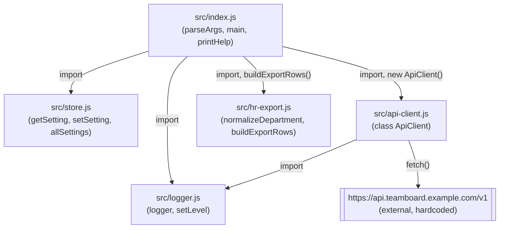

Single process, no network services, no build step. `package.json` declares
`"type": "module"` and runs straight off `src/index.js` via `node` — there is
no bundler, no TypeScript compile step, no `dist/`.

Notes on the non-obvious edges:

- `ApiClient` is only constructed inside `main()`'s `tasks` and `hr-export`
  command branches (`src/index.js:59`, `src/index.js:67`) — `status` and
  `help` never touch the network.
- The `hr-export` command paginates `client.listMembers(page)` itself
  (`src/index.js:69-76`), looping until a batch comes back shorter than 50 —
  unlike the `tasks` command, which only ever fetches page 1.
- `src/hr-export.js` is a leaf module with no imports at all (not even
  `logger`) — it's pure data transformation (`normalizeDepartment`,
  `buildExportRows`) and is exercised entirely through its own unit tests, not
  through logging output.
- `ApiClient` imports `logger` directly (`src/api-client.js:11`) rather than
  receiving it injected, so retry/backoff logging (`request()`,
  `src/api-client.js:19-39`) always goes through the same global logger
  instance the CLI configures via `setLevel`.
- There is no reverse edge: `logger.js`, `store.js`, and `hr-export.js` have
  no knowledge of each other or of `index.js` — all three are leaf modules.
