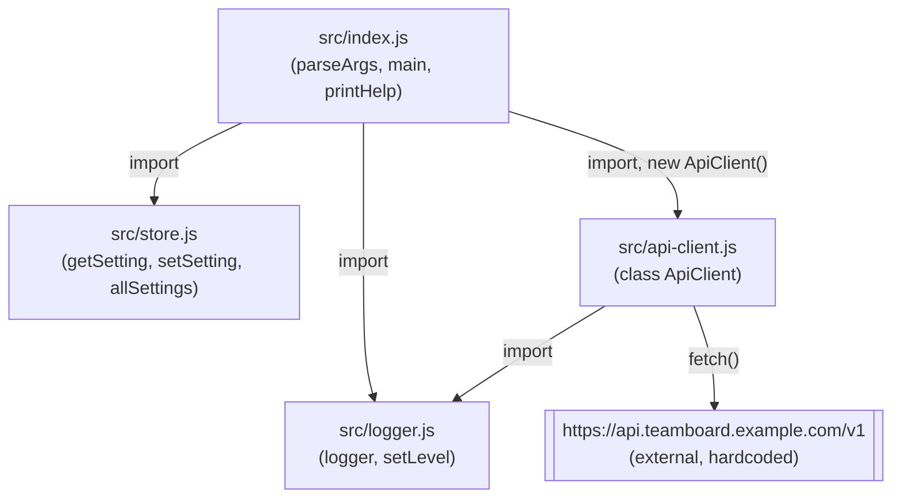

Single process, no network services, no build step. `package.json` declares
`"type": "module"` and runs straight off `src/index.js` via `node` — there is
no bundler, no TypeScript compile step, no `dist/`.

Notes on the non-obvious edges:

- `ApiClient` is only constructed inside `main()`'s `tasks` command branch
  (`src/index.js:57`) — `status` and `help` never touch the network.
- `ApiClient` imports `logger` directly (`src/api-client.js:11`) rather than
  receiving it injected, so retry/backoff logging (`request()`,
  `src/api-client.js:19-39`) always goes through the same global logger
  instance the CLI configures via `setLevel`.
- There is no reverse edge: `logger.js` and `store.js` have no knowledge of
  each other or of `index.js` — both are leaf modules.
