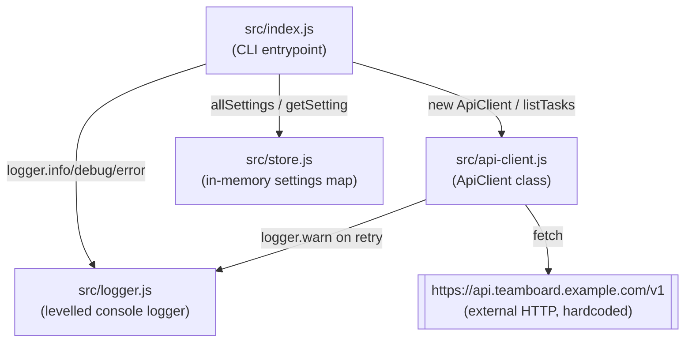

Four files, no external runtime dependencies, all imported via relative ESM paths.

Notes:
- `store.js` and `api-client.js` never import each other — the only shared dependency between them is `logger.js`. `index.js` is the sole point wiring all three together.
- `ApiClient` takes an optional `baseUrl` constructor arg but `index.js` always constructs it with no argument, so the hardcoded default (`https://api.teamboard.example.com/v1`) is what actually runs.
- No config/env layer sits between these modules and their hardcoded values — see [[overview]] for the README divergence on this point, and [[fixture-invariants]] for why that's intentional.
